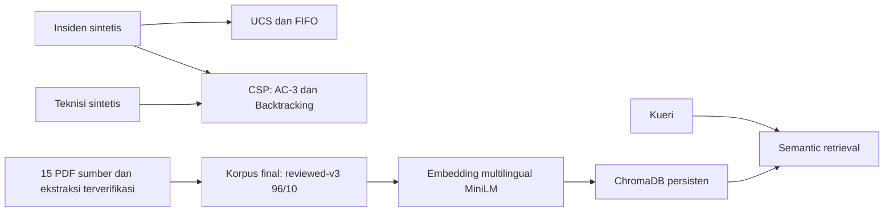

# Sistem Pendukung Keputusan Berbasis AI untuk Prioritisasi dan Penanganan Insiden Jaringan Kampus

**CERTAN** ? proyek akhir Kecerdasan Buatan (10S3001), Program Studi Sarjana Sistem Informasi, Institut Teknologi Del. Prototipe akademik ini mencakup prioritisasi insiden, penugasan teknisi dan pencarian rujukan jaringan.

## Ringkasan masalah

Urutan laporan masuk belum tentu sesuai dengan urgensi dan dampak gangguan jaringan. Penanganan juga memerlukan teknisi dengan skill dan slot yang tersedia, serta rujukan yang dapat ditelusuri sumbernya.

## Tujuan sistem

1. Membandingkan urutan penanganan UCS dengan FIFO menggunakan fungsi biaya yang sama.
2. Menemukan penugasan teknisi dan slot yang memenuhi constraint melalui CSP.
3. Mengambil dokumen pengetahuan yang relevan menggunakan embedding multilingual dan ChromaDB persisten.

Hasil sistem merupakan rekomendasi. Keputusan operasional tetap pada administrator jaringan.

## Arsitektur proyek



Ketiga milestone memiliki CLI terpisah. Prioritas UCS belum diteruskan otomatis sebagai constraint atau objective CSP; retrieval belum terhubung ke pengambilan keputusan operasional.

## Teknologi

Python 3.11+, `uv`, pytest, sentence-transformers, NumPy, ChromaDB, pypdf, requests dan BeautifulSoup. Model T03 adalah `sentence-transformers/paraphrase-multilingual-MiniLM-L12-v2`: 384 dimensi, vektor ternormalisasi, input maksimum 128 token. Versi dependency terkunci dalam [uv.lock](uv.lock); lisensi kode proyek adalah [MIT](LICENSE). Hak sumber korpus tercatat terpisah dalam manifest.

## Struktur repository

```text
src/proyek_certan/       implementasi M1, constraint_solver/ M2, knowledge/ M3
  corpus/               utilitas persiapan dan reproduksi korpus historis
data/
  sample_*.json         fixture sintetis M1/M2 dan kontrak integrasi M3
  corpus/
    raw/                15 PDF asli, dipertahankan
    final/              SATU korpus aktif: 15 TXT, 487 chunk, manifest
    processed/          bukti historis v1, reviewed-v2, reviewed-v3
docs/milestone-{1,2,3}/  dokumentasi milestone
evaluation/
  benchmarks/           evaluator resmi final
  results/              hasil verifikasi cleanup dan indeks navigasi hasil
  experiments/          navigasi kandidat yang ditolak
  archive/              inventaris dan navigasi bukti historis
  quality-v3/           protokol, label, observasi, hasil dan locked-code beku
tests/                  unit test dan integration test ketiga milestone
.local/ dan .cache/     database/cache lokal; diabaikan Git
```

Berkas riset lama tetap pada path aslinya karena import, protokol dan hash bergantung pada lokasi tersebut. [Indeks evaluasi](evaluation/README.md) membedakan final, historis, kandidat ditolak dan generated. Tidak ada penghapusan riwayat demi mengurangi jumlah berkas.

## Instalasi

Jalankan dari root repository, di PowerShell atau Bash:

```bash
git clone https://github.com/RonyPangaribuan/Proyek-Certan.git
cd Proyek-Certan
uv sync --locked
```

Pemakaian model pertama memerlukan unduhan Hugging Face. Cache berikutnya tersimpan di `.cache/models/`. Database lokal dapat diregenerasi dari korpus final; tidak dimasukkan Git.

## Quick start Milestone 1

```bash
uv run --locked proyek-certan --input data/sample_incidents.json
```

CLI menampilkan importance score, urutan UCS/FIFO, weighted-minute penalty dan statistik pencarian. Format data, bobot dan hasil lengkap ada di [panduan M1](docs/milestone-1/usage.md).

## Quick start Milestone 2

```bash
uv run --locked python -m proyek_certan.constraint_solver.assignment_cli --incidents data/sample_incidents.json --technicians data/sample_technicians.json
uv run --locked python -m proyek_certan.constraint_solver.benchmark --runs 10
```

Solver mencari assignment lengkap dan valid, tanpa objective optimasi. Detail domain, constraint dan statistik ada di [panduan M2](docs/milestone-2/usage.md).

## Quick start Milestone 3

x`Satu konfigurasi resmi: `v3_t96_w10`, 487 chunk, maksimum **96 token termasuk special tokens**, overlap yang diminta **10 kata**. Input aktif selalu [korpus final](data/corpus/final/README.md). Jalur berikut memeriksa manifest, hash, isi indeks dan model sebelum digunakan:

```bash
uv run --locked python -m proyek_certan.knowledge.final_cli verify
uv run --locked python -m proyek_certan.knowledge.final_cli index
uv run --locked python -m proyek_certan.knowledge.final_cli verify --index
uv run --locked python -m proyek_certan.knowledge.final_cli search --query "Bagaimana diagnosis resolusi nama DNS pada klien?" --top-k 5
uv run --locked python -m proyek_certan.knowledge.final_cli search --query "Bagaimana diagnosis resolusi nama DNS pada klien?" --document-level --top-k 5
```

Indeks resmi berada di `.local/chroma-corpus-final/`. Indeks yang isinya tidak cocok ditolak; jangan mencampurnya dengan database lama. Tidak ada threshold abstention yang diadopsi. Hasil semantik masih dapat memuat dokumen yang tidak relevan.

CLI generik lama tetap tersedia untuk kompatibilitas dan fixture; perintah historis bukan jalur korpus final. [Panduan utama M3](docs/milestone-3/README.md) menjelaskan konfigurasi, provenance dan batas reproduksi.

## Pengujian

```bash
uv run --locked python -m pytest -q
uv run --locked python evaluation/benchmarks/final_pipeline.py
uv run --locked python evaluation/benchmarks/final_pipeline.py --live
uv lock --check
git diff --check
```

`--live` membutuhkan indeks final dan cache model; menjalankan regresi 15 kueri lama, serta memeriksa seluruh token. Evaluasi validation/final test direplay dari observasi beku tanpa retrieval ulang atau pemilihan kandidat baru.

Aktifkan integration test model asli dengan PowerShell:

```powershell
$env:CERTAN_RUN_MODEL_TESTS = "1"
uv run --locked python -m pytest -q
```

Pada Bash, gunakan `CERTAN_RUN_MODEL_TESTS=1 uv run --locked python -m pytest -q`. Tanpa variabel tersebut, tes model asli akan ditandai skipped. [Laporan cleanup](docs/milestone-3/repository-cleanup.md) mencatat pemeriksaan yang benar-benar dijalankan.

## Hasil utama

| Pengukuran | Hasil tercatat |
|---|---|
| M1, 12 insiden sintetis | UCS 1412,5903; FIFO 1531,3458; pengurangan penalty 7,75% |
| M2, 12 insiden dan 5 teknisi | solved; 12 assignment; validasi passed |
| M3, benchmark lama 12 relevan + 3 OOD | Recall@3 0,8750; MRR 0,8056; Top-1 benar 8/12 |
| M3, final test v3: 24 relevan + 24 OOD | Semantic baseline: Recall@3 0,9167; MRR 0,8122 |
| M3, diagnosis threshold historis 0,5 pada final test | FAR 18/24 (75%); FRR 0/24 |

Angka berasal dari split berbeda dan tidak menunjukkan kenaikan langsung sebelum/sesudah. Guardrail dan reranking judul ditolak; peningkatannya tidak memenuhi kriteria adopsi. [Hasil dan keputusan v3](docs/milestone-3/final-quality-v3.md) tetap utuh. Cleanup mengubah organisasi dan rute penggunaan, bukan angka penelitian atau algoritma.

## Dokumentasi milestone

- M1: [penggunaan](docs/milestone-1/usage.md), [perumusan masalah](docs/milestone-1/01-problem-framing.md), [desain UCS](docs/milestone-1/06-search-algorithm-design.md).
- M2: [penggunaan](docs/milestone-2/usage.md), [formulasi CSP](docs/milestone-2/formulasi-csp.md), [desain data](docs/milestone-2/desain-data-constraint.md), [pengujian](docs/milestone-2/rancangan-pengujian.md).
- M3: [panduan utama](docs/milestone-3/README.md), [manifest final](data/corpus/final/manifest.json), [evaluasi](evaluation/README.md), [laporan cleanup](docs/milestone-3/repository-cleanup.md).

## Batasan sistem

- Insiden dan teknisi sintetis; UCS ditujukan untuk batch kecil karena jumlah state tumbuh eksponensial. Pengujian utama M1/M2 mencakup maksimum 12 insiden.
- Skill dan availability teknisi tetap dalam satu proses solve. CSP belum mencakup lokasi, jarak, beban historis atau objective prioritas UCS.
- Korpus eksternal berisi 13 dokumen Inggris dan 2 Indonesia; bukan SOP resmi IT Del. DOC-09/10 tetap **DRAFT**; DOC-11 masih memiliki catatan review tabel/diagram.
- WiFi diagnosis dapat menempatkan kebijakan DOC-13 di atas panduan DOC-01. OOD belum ditangani dengan presisi yang memadai; similarity bukan probabilitas relevansi atau pengesahan sumber.
- Label baru masih disusun oleh pihak yang sama; anotasi manusia independen belum selesai. Sistem belum menyediakan diagnosis otomatis, monitoring real time, LLM, RAG agent atau antarmuka pengguna.

Repository dapat diserahkan sebagai prototipe akademik beserta bukti dan keterbatasannya. Pemenuhan seluruh deskriptor nilai 100 dan kesiapan produksi belum terbukti.

## Anggota tim

| Nama |
|---|
| Rony Reynaldy Pangaribuan |
| Doydenggan Simanjuntak |
| Indah Nainggolan |
