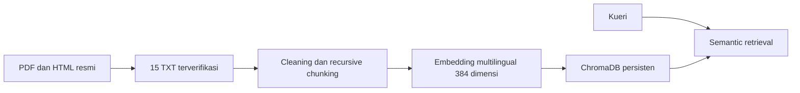

# CERTAN

Prototipe akademik **Sistem Pendukung Keputusan Berbasis AI untuk Prioritisasi dan Penanganan Insiden Jaringan Kampus**, mata kuliah 10S3001 Kecerdasan Buatan, Institut Teknologi Del.

CERTAN mencakup prioritisasi insiden dengan UCS/FIFO (M1), penugasan teknisi menggunakan CSP (M2), dan basis pengetahuan dengan pencarian semantik (M3). Ketiganya masih berupa CLI terpisah; hasilnya merupakan rekomendasi untuk pemeriksaan manusia.

## Mulai di sini

- **Milestone 3:** [panduan dan demonstrasi](docs/milestone-3/README.md), [pipeline dan sumber](docs/milestone-3/pipeline.md), [evaluasi dan keterbatasan](docs/milestone-3/evaluation.md).
- **Milestone 1:** [penggunaan UCS/FIFO](docs/milestone-1/usage.md).
- **Milestone 2:** [penggunaan CSP](docs/milestone-2/usage.md).

## Instalasi

Python 3.11+ dan `uv`; jalankan dari root repository:

```bash
uv sync --locked
```

Model pertama kali memerlukan unduhan Hugging Face. Cache berada di `.cache/models/`; indeks ChromaDB berada di `.local/chroma-final-recursive/`. Kedua lokasi diabaikan Git. Versi dependency ada pada [uv.lock](uv.lock).

## Demonstrasi Milestone 3

Satu korpus aktif: **15 dokumen, 503 chunk**, profil `recursive_t96_w10`.

```bash
uv run --locked python -m proyek_certan.knowledge.final_cli verify
uv run --locked python -m proyek_certan.knowledge.final_cli build
uv run --locked python -m proyek_certan.knowledge.final_cli index
uv run --locked python -m proyek_certan.knowledge.final_cli verify --index
uv run --locked python -m proyek_certan.knowledge.final_cli search --query "Bagaimana diagnosis DNS pada klien?" --document-level --top-k 5
```

`build` mengulang ingestion teks terverifikasi, normalisasi dan chunking, lalu membandingkan hasilnya dengan korpus terdaftar. `index` mengisi database persisten; indeks campuran atau usang ditolak. Gunakan lokasi kosong melalui `--db` jika membutuhkan indeks terisolasi.



Tiga belas TXT berasal dari HTML resmi dan dua dari PDF native. Snapshot TXT memungkinkan pembangunan ulang offline; 15 PDF asli tetap disimpan. Korpus eksternal ini belum merupakan SOP resmi kampus.

## Evaluasi dan pengujian

```bash
uv run --locked python -m pytest -q
uv run --locked python evaluation/benchmarks/final_pipeline.py
uv run --locked python evaluation/benchmarks/final_pipeline.py --live
```

Evaluator standar memeriksa korpus dan me-replay metrik baseline dari bukti beku. `--live` memeriksa reproduksibilitas, indeks, dan regresi kueri yang sudah pernah dilihat. Pengukuran baru dipisahkan dari final test penelitian lama. [Penjelasan evaluasi](docs/milestone-3/evaluation.md) menjelaskan hasil, threshold, dan kelemahannya.

Tes model asli dapat diaktifkan di PowerShell dengan `$env:CERTAN_RUN_MODEL_TESTS = "1"` sebelum pytest; tanpa itu tes terkait model ditandai skipped.

## Milestone 1 dan 2

```bash
uv run --locked proyek-certan --input data/sample_incidents.json
uv run --locked python -m proyek_certan.constraint_solver.assignment_cli --incidents data/sample_incidents.json --technicians data/sample_technicians.json
```

Implementasi M1/M2 dipertahankan. Data insiden/teknisi sintetis; solver CSP mencari assignment valid tanpa objective optimasi.

## Struktur dan arsip

| Lokasi | Fungsi |
|---|---|
| [src/proyek_certan](src/proyek_certan/) | Kode M1/M2, `corpus/` untuk preprocessing, `knowledge/` untuk M3 |
| [data/corpus/raw](data/corpus/raw/) | 15 PDF sumber |
| [data/corpus/final](data/corpus/final/) | Satu korpus aktif dan manifest provenance |
| [evaluation](evaluation/) | Evaluator, benchmark aktif dan bukti penelitian terpilih |
| [tests](tests/) | Pengujian implementasi aktif |

Riwayat lengkap sebelum pengurangan file tersimpan pada tag **`archive/m3-before-minimal-cleanup-20261106`**, commit `bc0c4c1a49d977236378c73e26794332b2056c54`. Buka arsip dalam worktree terpisah:

```bash
git -c core.autocrlf=false worktree add ../CERTAN-M3-research archive/m3-before-minimal-cleanup-20261106
```

Tag bersifat lokal sampai dikirim ke remote. Saat membagikan repository, sertakan tag tersebut dengan `git push origin archive/m3-before-minimal-cleanup-20261106`. [Inventaris cleanup dan checksum bukti](evaluation/evidence.json) mencatat file yang dikeluarkan. Laporan dan eksperimen historis dibaca menurut versi asalnya.

## Tim dan lisensi

Rony Reynaldy Pangaribuan, Doydenggan Simanjuntak, dan Indah Nainggolan. Kode berlisensi [MIT](LICENSE); hak penggunaan sumber korpus dicatat terpisah pada manifest.
